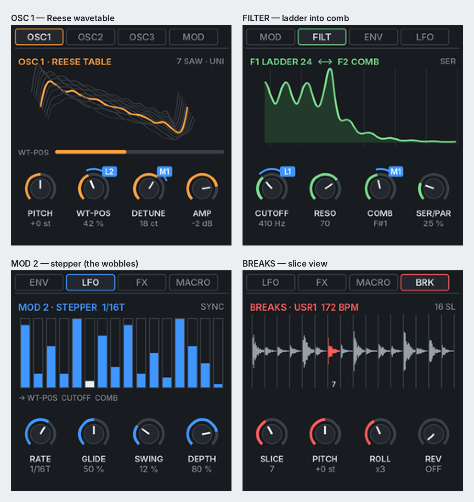

# Phase 0 feasibility report

Short version: **DREADNOUGHT is buildable on the FM-1, but not at full Massive-on-a-laptop scale.**
The chip is a 240 MHz dual-core with no hardware floating point, ~512 KB of RAM and 1 MB of flash for
*everything*. The community has already proved 8–16 rich synth voices, a sampler, a drum machine, stereo
reverb and a 64-step sequencer with p-locks run on it, so the core of the vision fits. What doesn't fit
is "everything at once at full size": 8 heavy engines playing together, full-size Serum tables, long
effect buffers everywhere. Below is what fits, what gets cut down, and the one decision I need from you.

Facts and sources are in [PLATFORM.md](PLATFORM.md). Numbers marked *estimate* get measured on the device in Phase 1.

## Decision needed: which base to build on

| | FM1 Open (M-VAVE) | **SLOOP + Clipper (recommended)** |
|---|---|---|
| Audio engine | Closed binary, "sealed" audio API | Full source, ours to change |
| Build | Windows only, vendor `.exe` toolchain | Linux, so GitHub Actions runs it as-is |
| Already has | 8 tracks, DX7, 303, 808, sampler | 4-track groovebox, p-locks, micro-timing, fills, samples, slicer, 27 punch-in FX, stereo FX, dual-core, WebMIDI installer, SysEx editor, WebAssembly preview, golden-render tests |
| Synth voice | DX7, 303, PSG | Clipper's HYBRID: 3 osc (incl. 7-saw supersaw, sync, fold, FM), 2 filters series/parallel (incl. Moog ladder), matrix, macros — close to the Massive voice |
| Licence | GPLv3 + linking exception, binary SDK | GPL-3.0-only (we already are) |

**Recommendation:** fork **SLOOP 2.8.1** as the groovebox skeleton (tracks, sequencer, sampler,
storage, installer, tests), and bring in **Clipper's HYBRID voice** as the starting point for the shared
Massive-style voice. Both are by isod89, from the same Felucca codebase, under the same licence, so
they merge cleanly. FM1 Open stays a reference for hardware facts.

The Phase 0 CI already builds unmodified SLOOP 2.8.1 to prove the toolchain and package steps.

## CPU budget

One 128-frame block lasts 2.9 ms, i.e. about 700,000 cycles per core at 240 MHz. Fixed-point only.

What existing firmware shows: SLOOP plays 8 synth voices shared across its 3 synth tracks plus 6 drum
voices, all with FX; Clipper plays 8 HYBRID voices by default and offers 12 or 16 as a build option using both cores (its author still asks players to measure that). Lighter voices
(sample playback, sine 808) cost a fraction of a HYBRID voice.

**Proposed voice budget** (*estimate*, two cores, target ≤ 75 % worst case):

| Track | Engine | Voices | Notes |
|---|---|---|---|
| 1 | BREAKS | 4 slice voices | Sample playback, cheap; rolls reuse voices |
| 2 | KIT | 6 | As SLOOP's drums |
| 3 | REESE | 1 (mono) | One HYBRID-class voice with up to 7 saws inside it |
| 4 | DREAD | 1 (mono) | HYBRID-class voice + stepper |
| 5 | WAVE | shares the pool | Leads mono, chords from the pool |
| 6 | FM | up to 4 | FM6 is heavy: SLOOP caps it at 6 when it plays alone |
| 7 | 808 | 1 (mono) | Sine + distortion, cheap; the one place 2× oversampling is affordable |
| 8 | PAD / STAB | shares the pool | Pads are the most expensive thing here |

The polyphonic tracks (WAVE, FM, PAD/STAB) **share a pool of about 8–10 voices**. All 8 tracks
sequence at once; the limit is on how many poly notes ring together. Voice stealing with fades, never clicks.

## RAM budget (~512 KB)

| Item | Size | Plan |
|---|---|---|
| Firmware data, UI, sequencer (SLOOP today) | ~58 KB region + ~336 KB pool | Pool is nearly full today, so we free space before adding |
| SLOOP's 1.49 s delay line | 128 KB (65,536 mono 16-bit samples) | Shrink, or share with beat-repeat |
| Big dark reverb | 30–60 KB | FDN at a reduced internal rate |
| Beat repeat / tape stop buffer (1 bar at 172 BPM ≈ 1.4 s) | ~120 KB mono | **Shares the delay's memory**: you can't have a 1.5 s dub delay and a full-bar stutter at the same time |
| Active wavetables | 32–64 KB each | Only the tables in use are in RAM |
| Doubling tracks 4 → 8 | patterns, locks, voices state | *estimate* 15–25 KB; patterns live in flash, the playing pattern in RAM |

## Flash budget (1 MB total)

Firmware ~600–700 KB, so **about 300 KB** is left for user data: roughly **15 s of samples** (ADPCM)
shared by breaks, kit sounds, resampled audio and user wavetables.

## Feature by feature

| Feature | Fits? | What changes |
|---|---|---|
| Reese engine (7 saws, sub, ladder, comb, drift, Hoover) | Yes | Mono, as a HYBRID-class voice |
| Dread / donk / wobble, stepper LFO, slides | Yes | |
| 808 with 7 distortion modes, clean-sub split, slides, sidechain | Yes | ADAA by default, 2× oversampling on this mono voice only |
| Shared Massive-style voice (3 osc, 2 filters, 4 env, 4 mod, 8 macros) | Yes, at low polyphony | Full structure on mono basses; pads/stabs get fewer modulators per voice if needed |
| Wavetable engine | Yes | Frames of 256 samples (not 2048), up to 64 frames, band-limited mip levels |
| Serum import | Yes, reduced | A full Serum table (256 × 2048 × 16-bit) is 1 MB. Import keeps up to 64 frames and resamples to 256 samples: ~32 KB each. **2–4 user tables fit**, sharing space with samples. Most factory tables are generated on the device, so they cost no flash. Every table also stays a normal Serum WAV in the repo. |
| BREAKS chopper (auto/grid/manual slices, per-step slice/reverse/pitch/rolls) | Yes | ~15 s total sample time, so about 2 full breaks loaded |
| Jungle Mangler, stutter, half/double time | Yes | |
| Timestretch "Akai zippy" mode, granular pad | Partly | 8–16 grains, mono |
| Resampler | Partly | Records to RAM (2–3 s), saved to a slot **while stopped**: writing flash briefly silences audio |
| Dub delay, big reverb, space echo, inserts, master glue/limiter | Yes | Shorter buffers than a plugin; delay and beat-repeat share memory |
| Performance FX (stutter, tape stop, vinyl brake, DJ filter…) | Yes | SLOOP already has 27 punch-in effects |
| PAD (atmos, strings, choir, granular, Reese pad, FM glass) | Yes, low polyphony | 4–6 notes. Pads are the first thing to lose voices |
| STAB (chord memory, dub, techstep, hoover, rave organ, FM) | Yes | Chords use the shared pool |
| 8 tracks, 64 steps, p-locks, probability, polymeters, scenes, MIDI | Yes | Patterns in flash, current pattern in RAM |
| On-device Massive-style UI | Yes | 240 × 240 **colour** screen, KNOB 1–4 under it: see the mock |
| Web editor with drag-to-modulate and WebAssembly preview | Yes | SLOOP already compiles its DSP to WebAssembly for preview |
| Web flasher | **Done in Phase 0** | Tested end to end against a simulated FM-1, including resume after a cut-off |
| One-click return to stock firmware in the browser | No | SLOOP removed this because it wasn't reliable on all systems. We link to M-VAVE's Workbench / M-UPGRADE instead |

## On-device UI mock

Each page is one tab; ALGORITHM steps through tabs, KNOB 1–4 under the screen are the four knobs on the
page. Blue rings show modulation depth with the source (L1, M1…) in a slot under the knob, as in Massive.
Regenerate with `python3 tools/ui_mock.py`.

## Revised phase plan

- **Phase 1** — Fork SLOOP 2.8.1 into the repo, rename to DREADNOUGHT (USB name, logo, identity `FM-1_9XY`),
  bring in Clipper's HYBRID voice, and make track 3 a mono REESE. Measure CPU on the device with the
  built-in CPU / LATE / PEAK readout.
- **Phase 2** — REESE and DREAD complete, 808, master glue/limiter; 4 → 8 tracks.
- **Phase 3** — BREAKS chopper and the Jungle Mangler.
- **Phase 4** — WAVE engine, wavetable format, Serum import (CLI, CI, web), FM dark bank.
- **Phase 4b** — PAD and STAB.
- **Phase 5** — FX rework (memory sharing), resampler.
- **Phase 6** — Massive-style UI on device, the web editor, presets and demo patterns, releases.

## What's verified so far, and what isn't

| | |
|---|---|
| Hardware facts | Read from the official SDK headers and community sources, not measured by us |
| CI firmware build | **Works on GitHub**: the first run fetched the toolchain and SDK files, built and packaged the base, and uploaded the `.fwsc` artifact. The base's own host-test suite reported a failure (non-blocking in Phase 0; upstream notes a stale budget check) — to be read and fixed in Phase 1 |
| Web flasher | Unit tests (6) and a browser end-to-end test against a simulated FM-1 pass. **Not yet used on a real FM-1** |
| CPU/RAM numbers above | Estimates from SLOOP/Clipper's published figures; Phase 1 measures them |
